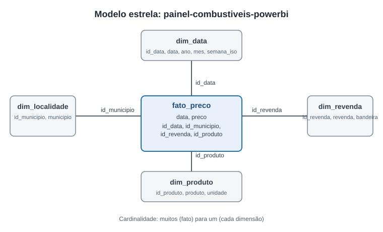
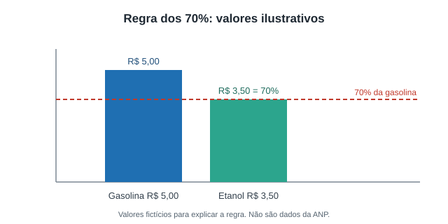

# painel-combustiveis-powerbi

Modelo estrela e painel em Power BI sobre preços de gasolina, etanol e diesel no estado do Rio de Janeiro. Segundo pilar do portfólio, depois de [combustiveis-sql-analytics](https://github.com/famel-svg/combustiveis-sql-analytics), que usa o mesmo dataset.



## Motivo do projeto

Este é um projeto de portfólio. Ele mostra modelagem dimensional e DAX aplicados a dados reais, habilidade pedida em vagas de BI. O dataset é o mesmo do projeto de SQL, então dá para comparar as duas abordagens sobre os mesmos números.

A pergunta vem de uma dúvida prática: quando abastecer com etanol compensa no bolso. A regra usada como critério é a dos 70%: o etanol compensa quando o preço por litro é até 70% do preço da gasolina.



O diagrama acima usa valores fictícios para explicar a regra. Não são dados da ANP.

## Estado do projeto

| Entregável | Situação |
|---|---|
| Modelo estrela (amostra em CSV) | Feito: `data/amostra/` |
| Power Query M (consultas nomeadas) | Feito: `powerquery/consultas.m`. Não testado no Power BI Desktop |
| Medidas DAX | Feito: `docs/medidas_dax.md`. Não testado no Power BI Desktop |
| Dicionário de dados | Feito: `docs/dicionario_de_dados.md` |
| `.pbix` com amostra | Não feito. Exige Power BI Desktop, que não rodei neste ambiente |
| PDF e prints das três páginas em `docs/` | Não feito. Depende do `.pbix` |
| Painel (3 páginas) | Não feito: visão geral com mapa e KPIs, comparação municipal, regra dos 70% |

O que falta depende de abrir o Power BI Desktop, montar as três páginas e exportar PDF e prints. Quando o `.pbix` existir, a amostra ou o `.pbix` completo entra no repositório como arquivo versionado. Se passar de 100 MB, usa Git LFS ou fica só a amostra.

## Modelo de dados

Tabela fato `fato_preco` com uma linha por preço observado, e quatro dimensões:

- `dim_data`: calendário dos dias com observação.
- `dim_produto`: gasolina, etanol, diesel e diesel S10.
- `dim_localidade`: município.
- `dim_revenda`: posto, com a bandeira mais frequente.

Dicionário completo em [docs/dicionario_de_dados.md](docs/dicionario_de_dados.md).

## Decisões de modelagem

- **Estrela, não flocos de neve.** Revenda e município são dimensões planas, porque o volume é pequeno e a consulta fica mais simples.
- **Chaves inteiras.** `id_data` no formato AAAAMMDD, demais chaves sequenciais. A coluna de texto fica no fato para conferência, mas os relacionamentos usam só os ids.
- **Calendário sem dias vazios.** `dim_data` só tem dias com observação. Por isso `DATEADD` e `SAMEPERIODLASTYEAR` não são confiáveis, e as medidas de variação deslocam o intervalo com `MIN`/`MAX` de `dim_data[data]`.
- **Uma bandeira por revenda.** Se um posto aparece com mais de uma bandeira, fica a mais frequente. O custo é perder essa variação; o ganho é uma chave de revenda única.
- **Sem CNPJ.** A coluna `cnpj_revenda` fica fora da amostra. A razão social do posto é mantida por ser dado público de empresa.
- **Recorte da amostra.** 2025-01 a 2025-03 e os 5 municípios com mais registros. Dá para abrir o modelo rápido sem baixar tudo.

## Como reproduzir a amostra

```bash
python scripts/gerar_amostra.py
```

O script lê o CSV limpo do projeto `combustiveis-sql-analytics` (`data/processed/precos_rj.csv`) e grava as cinco tabelas em `data/amostra/`. Usa só biblioteca padrão.

## Consultas Power Query

Cinco consultas nomeadas em [powerquery/consultas.m](powerquery/consultas.m). Todas leem o caminho do parâmetro `CaminhoAmostra`. Esse parâmetro precisa ser ajustado em cada máquina, porque o Power Query não resolve caminho relativo ao `.pbix` sozinho.

## Medidas DAX

Seis medidas em [docs/medidas_dax.md](docs/medidas_dax.md): preço médio, variação semanal e anual, média móvel de 4 semanas, ranking de município e percentual etanol sobre gasolina.

## O que faria diferente

- **Calendário completo.** Montaria `dim_data` com todos os dias do período e marcaria as datas sem coleta. Assim `DATEADD` e `SAMEPERIODLASTYEAR` funcionam direto, e a variação semanal usa semana ISO de verdade.
- **Testar as consultas antes de documentar.** Abriria o `.pbix` no Power BI Desktop antes de escrever a documentação de M e DAX. Hoje o código está documentado mas não rodou.
- **Parâmetro de caminho único.** Usaria um parâmetro de pasta do projeto desde o início, em vez de texto solto nas consultas.
- **Região metropolitana como dimensão.** A hipótese do projeto de SQL compara interior e Região Metropolitana. Essa classificação deveria estar em `dim_localidade` desde o começo, não calculada à parte.
- **Teste de significância.** A comparação entre regiões no projeto de SQL não tem teste estatístico. No painel, eu acrescentaria a medida com intervalo de confiança antes de chamar qualquer diferença de real.

## Fontes e licença

Dados da ANP, série semanal de preços, 2023 a 2025, recorte RJ. Origem e tratamento detalhados no projeto [combustiveis-sql-analytics](https://github.com/famel-svg/combustiveis-sql-analytics). A licença de uso ainda precisa ser conferida no texto dos "Termos de uso do portal da ANP" antes de publicar o repositório.

Dados públicos de empresa (razão social e bandeira de postos) entram na amostra. Nenhum dado pessoal é publicado.
